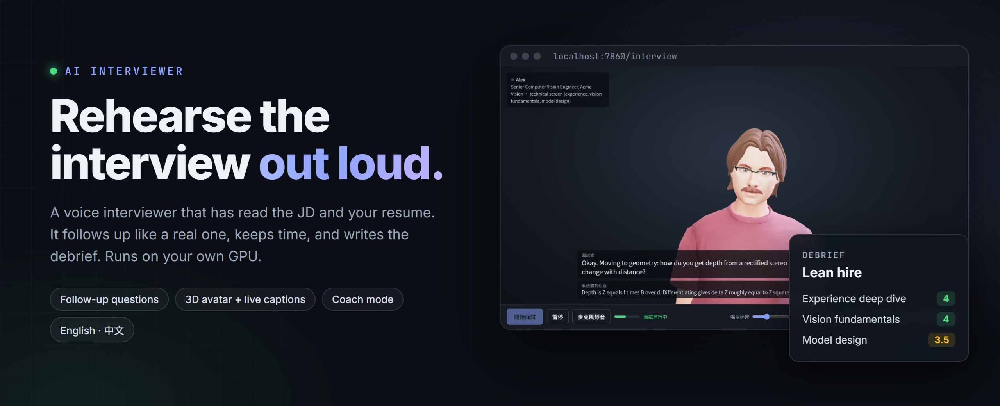
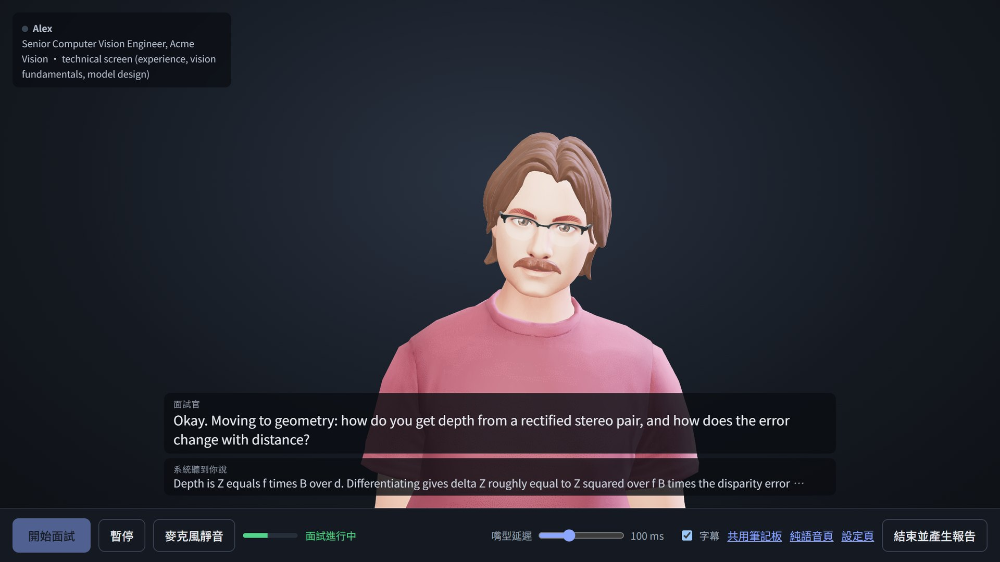
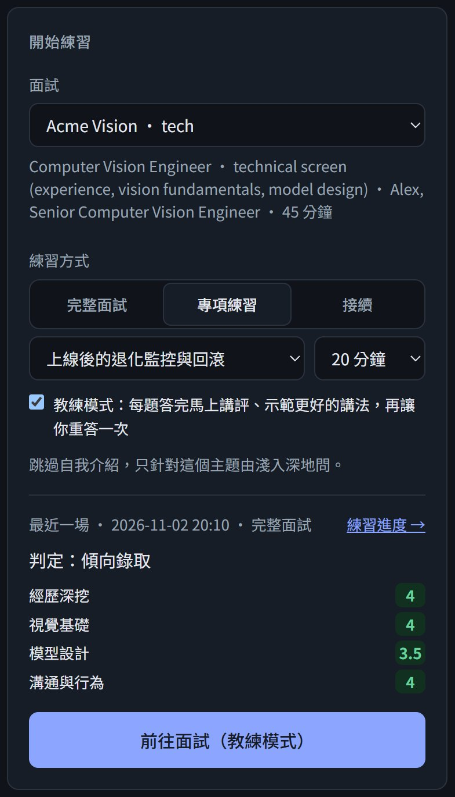
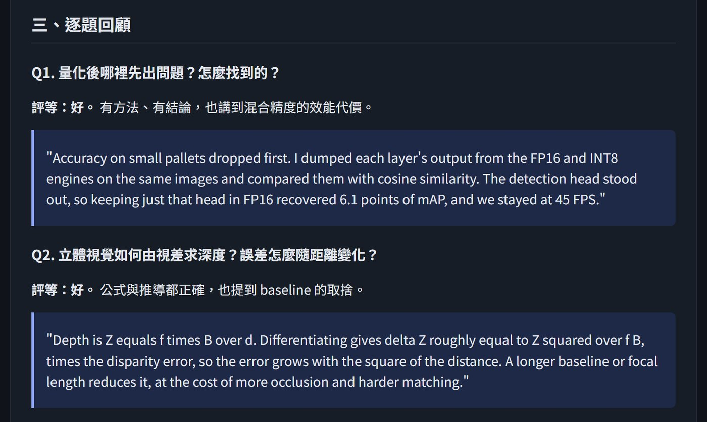
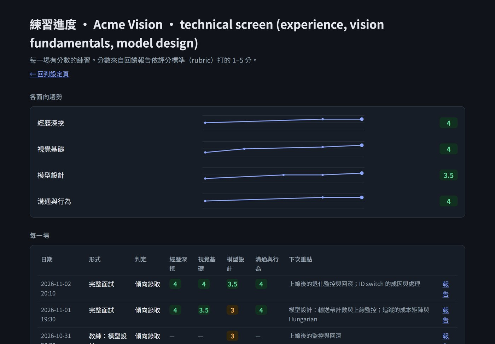
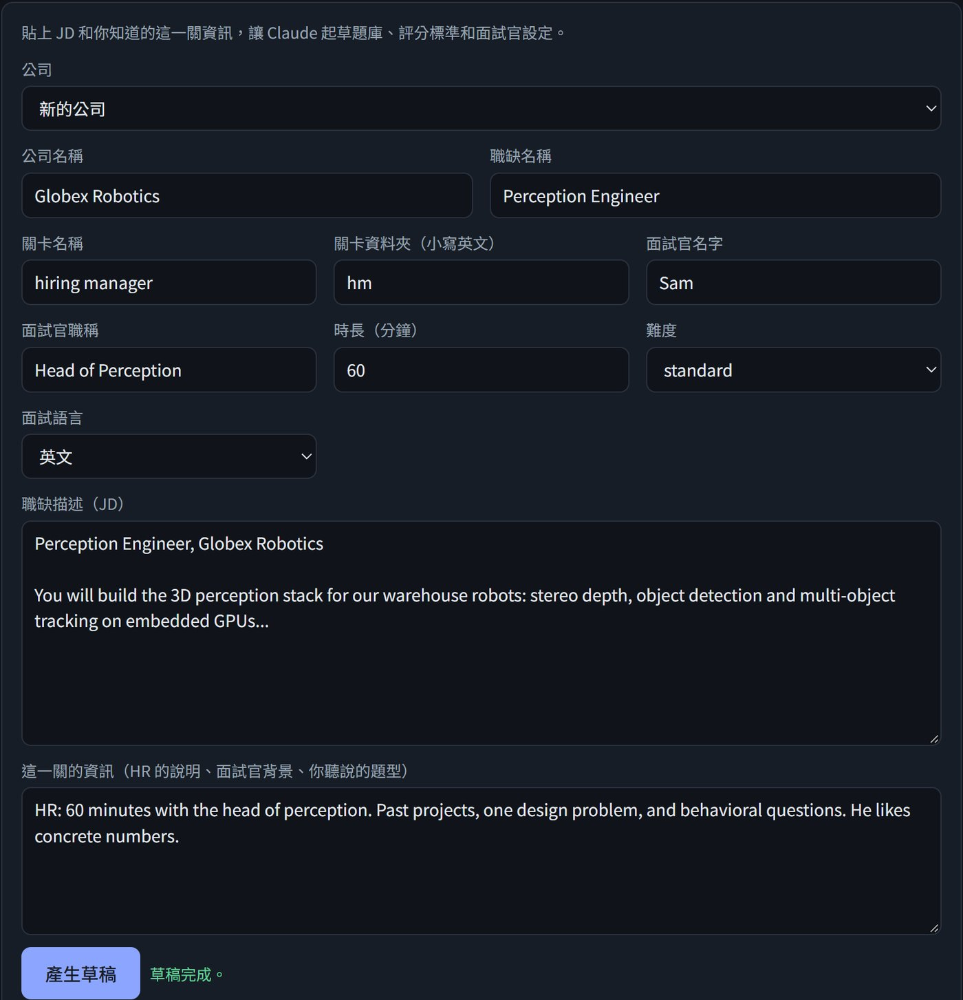
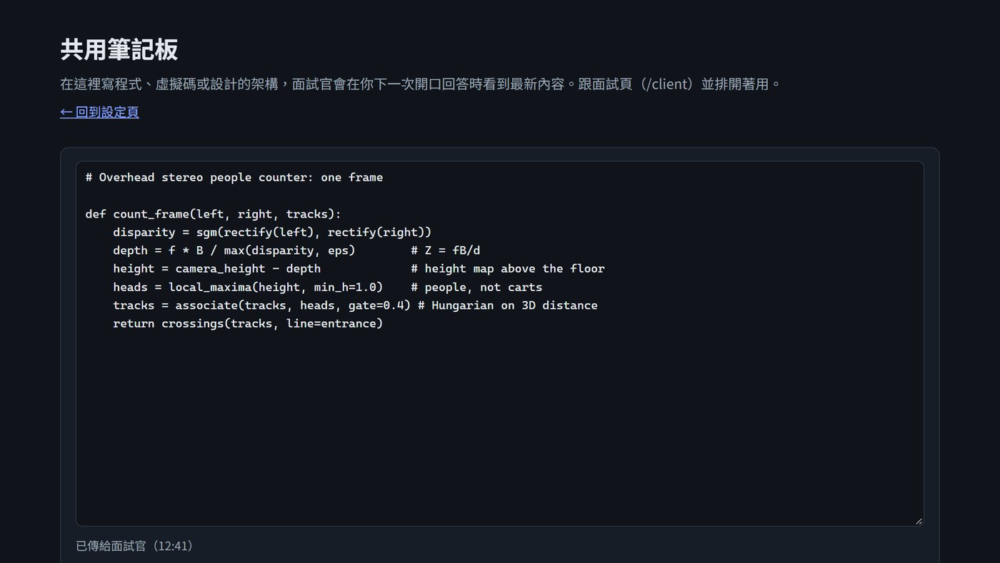
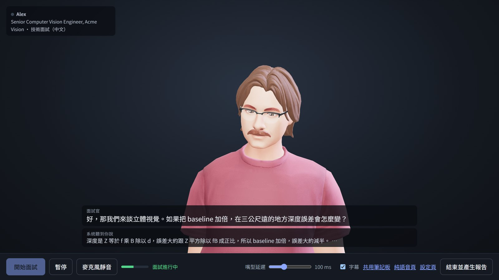
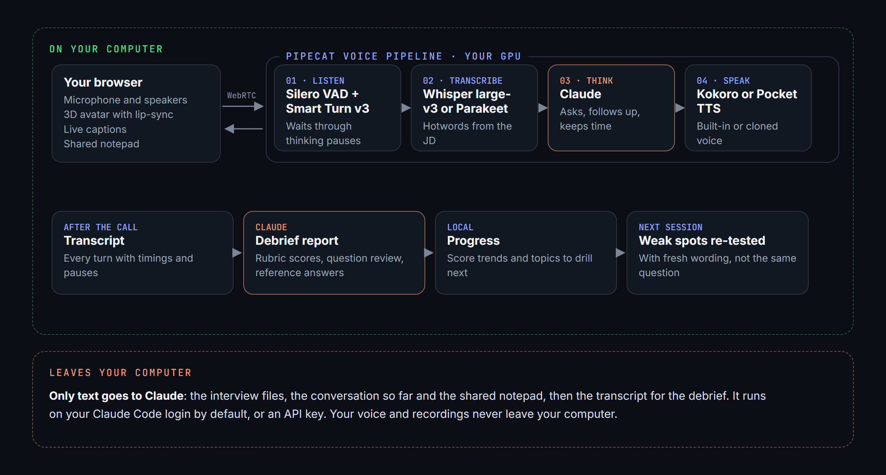

<p align="center">
  
</p>

<p align="center"><strong>Mock interviews, out loud.</strong></p>

<p align="center">A voice interviewer that has read the job description, your resume and what you know about the round.<br>It asks, follows up, keeps time and writes the debrief. Everything except the language model runs on your own GPU.</p>

<p align="center">
  <strong>English</strong> &nbsp;·&nbsp; <a href="README.zh-TW.md">繁體中文</a>
</p>

<p align="center">
  <a href="#see-it">See it</a> &nbsp;·&nbsp;
  <a href="#three-ways-to-practice">Three ways to practice</a> &nbsp;·&nbsp;
  <a href="#after-you-hang-up">After you hang up</a> &nbsp;·&nbsp;
  <a href="#what-the-interviewer-does">What the interviewer does</a> &nbsp;·&nbsp;
  <a href="#how-it-works">How it works</a> &nbsp;·&nbsp;
  <a href="#get-started">Get started</a> &nbsp;·&nbsp;
  <a href="INSTALL.md">Install guide</a>
</p>

<p align="center">
  
  
  
  
  
  <a href="LICENSE"></a>
</p>

---

## See it

<p align="center"></p>

> A technical screen for the fictional **Acme Vision** that ships in [`interviews/example/`](interviews/example/). The interviewer moves on to stereo geometry. Its question appears as a caption while it speaks, and the line below shows what speech recognition heard you say, so you can see a mishearing as it happens. The candidate and every score in these pictures are made up.

---

## Reading answers is not the same as saying them

You can know the answer and still lose it in the room. You start with the background instead of the point, you forget the number that made the project impressive, and the follow-up you didn't expect takes you apart.

The fix is to say your answers out loud to someone who pushes back. This is that someone, available at 1 a.m. the night before. It has read the JD, your resume and the notes you have on the round. It asks for the number when you leave it out, and it asks "why that and not the alternative" when you skip the trade-off. It remembers what you got wrong last time and asks again in different words.

---

## Three ways to practice

<table>
  <tr>
    <td width="38%" valign="top">
      
    </td>
    <td valign="top">
      <h3>1. Full mock interview</h3>
      From the introductions to "do you have any questions for me", following the structure of the round. It keeps to time and wraps up on its own.
      <h3>2. Focused drill</h3>
      Ten to thirty minutes on one topic, from the fundamentals to the follow-ups. Pick a topic the last report told you to work on, an area of the rubric, or type your own.
      <h3>3. Coach mode</h3>
      A drill where it stops after every answer. It says what worked, names what was missing, shows a better version built from your own experience, and asks you to try again.
      <br><br>
      You can pause any session. If the connection drops, continue the same session later.
    </td>
  </tr>
</table>

---

## After you hang up

<table>
  <tr>
    <td width="50%" valign="top">
      <br>
      <strong>A debrief in about a minute.</strong><br>
      Scores against the round's rubric, with quotes as evidence. The strongest and weakest moments. Every question rated, with a reference answer you could actually say, built only from your real experience. The follow-ups you haven't prepared for. Answer length, pauses and speaking rate.
    </td>
    <td width="50%" valign="top">
      <br>
      <strong>Progress you can see.</strong><br>
      Each rubric area as a trend across sessions, plus the verdict and the topics to work on next. Those topics become the suggested drills, and the interviewer reads your weak spots before the next session and comes back to them with fresh questions.
    </td>
  </tr>
</table>

---

## What the interviewer does

<table>
  <tr>
    <td width="50%" valign="top">
      <br>
      <strong>It prepares for each company and round.</strong><br>
      Paste the job description and what you know about the round. Claude drafts the round brief, a question bank, a scoring rubric and speech-recognition hotwords from the JD and your resume. You review them and press Create. Each company can have its own resume.
    </td>
    <td width="50%" valign="top">
      <br>
      <strong>It reads what you type.</strong><br>
      For coding and design questions, open the shared notepad next to the interview. The interviewer sees what you wrote the next time you speak, and asks about specific lines.
    </td>
  </tr>
  <tr>
    <td valign="top">
      <br>
      <strong>English or Mandarin.</strong><br>
      Set <code>interview_language: zh-TW</code> and the interview is held in Mandarin, in Taiwan Traditional Chinese with technical terms kept in English. Speech recognition, the voice, captions and the report all switch with it.
    </td>
    <td valign="top">
      <strong>It behaves like an interviewer, not a chatbot.</strong>
      <ul>
        <li>One question at a time, in short spoken sentences, with no praise for every answer.</li>
        <li>It probes when an answer is vague, says "we" without saying what you did, or skips the result.</li>
        <li>It waits through your thinking pauses instead of cutting in (Smart Turn v3), and stops talking when you interrupt.</li>
        <li><code>difficulty: tough</code> makes it push back harder and keep asking for numbers.</li>
        <li>A 3D avatar with lip-sync, rendered in your browser. Choose a built-in voice, or clone one you have permission to use.</li>
      </ul>
    </td>
  </tr>
</table>

---

## How it works

<p align="center"></p>

| Part | What runs it |
|---|---|
| Voice pipeline | [Pipecat](https://github.com/pipecat-ai/pipecat) 1.12 over WebRTC |
| Turn taking | Silero VAD + Smart Turn v3, on your machine |
| Speech recognition | Whisper large-v3 (faster-whisper) or NVIDIA Parakeet TDT 0.6B v3, on your GPU. `compare_stt.py` compares them on your own voice |
| Interviewer | Claude, through your Claude Code login by default, or an Anthropic API key |
| Voice | Kokoro (GPU), Pocket TTS for built-in or cloned voices (CPU), Kokoro v1.1-zh for Mandarin |
| Avatar | [TalkingHead](https://github.com/met4citizen/TalkingHead) with [HeadAudio](https://github.com/met4citizen/HeadAudio) lip-sync, in the browser |

---

## Get started

**You need**

- Linux, or WSL2 on Windows
- An NVIDIA GPU with 6 GB of VRAM or more, and a driver that supports CUDA 12
- Python 3.10 to 3.12
- **Claude Code**, signed in (or an Anthropic API key)
- Headphones, so the interviewer doesn't hear itself

**Then**

```bash
./setup_gpu.sh                  # creates the venv, installs packages, switches to GPU onnxruntime
source .venv/bin/activate
source cuda_env.sh              # makes the CUDA libraries visible; run in every new terminal
python download_models.py       # downloads the models (about 4 GB) and checks the GPU
python bot.py                   # then open http://localhost:7860/
```

Pick the example interview, choose how to practice, and press 「前往面試」 (Go to interview). The web interface is in Traditional Chinese. The full walkthrough with troubleshooting is in **[INSTALL.md](INSTALL.md)**, and every setting is in **[docs/reference.md](docs/reference.md)**.

To prepare for a real interview, use 「新增公司或關卡」 (Add a company or round) on the start page, or copy [`interviews/_template/`](interviews/_template/). Your own company folders, resumes, transcripts and voice recordings are in `.gitignore` and stay on your machine.

---

## Privacy and cost

- **What leaves your computer:** only text sent to Claude. That is the interview files and the conversation during the interview, then the transcript when the debrief is written. Your voice and any saved recordings stay on disk.
- **Cost:** with the default Claude Code backend, the interviewer runs on your Claude plan and counts toward its usage limits. With `LLM_BACKEND=api`, you pay per token at Claude API prices. Everything else is free and local.

## Limitations

- The web interface is in Traditional Chinese only. Interviews can be in English or Mandarin.
- Developed and tested on WSL2 (Ubuntu) with an NVIDIA GPU; plain Linux should work the same. Native Windows and macOS are not supported.
- The Mandarin voice has a mainland accent and reads English terms less naturally; that is the current limit of small local models.
- Timings are approximate, and Whisper drops some "uh"s and "um"s, so filler words can only be judged roughly.
- Clone only voices you have the right to use, with the speaker's consent.

---

## Documentation

- [INSTALL.md](INSTALL.md): requirements, setup, your first interview, troubleshooting.
- [docs/reference.md](docs/reference.md): interview folders, reports and progress, continuing after a disconnect, every setting, the Mandarin mode, speech-recognition models, and the code layout.

<details>
<summary><strong>How the code is laid out</strong></summary>

```text
bot.py                the voice pipeline: timing, ending, drills and coach mode, notepad
session_picker.py     the web pages and their API
claude_code_llm.py    the interviewer through the Claude Code CLI, with recovery if it crashes
whisper_stt.py        Whisper with conversation context and hallucination filters
parakeet_stt.py       Parakeet, re-transcribing each whole answer
compare_stt.py        compares speech-recognition models on your own recordings
chinese.py            Mandarin text: Traditional conversion, spacing, character counts
chinese_tts.py        the Mandarin voice (Kokoro v1.1-zh)
feedback.py           the debrief and scores
analysis.py           answer length, pauses and speaking rate
history.py            weak spots and questions across sessions, progress data
interview_config.py   loads interview folders, checks settings, fills prompt templates
setup_wizard.py       drafts and creates a new company or round
resume_import.py      turns an uploaded resume into resume.md
prompts/              interviewer, debrief, resume and setup prompt templates
interviews/           one folder per company, one subfolder per round
web/                  start page, interview page, report, progress, notepad
tests/                automated tests (no GPU, network or Claude needed)
```

</details>
