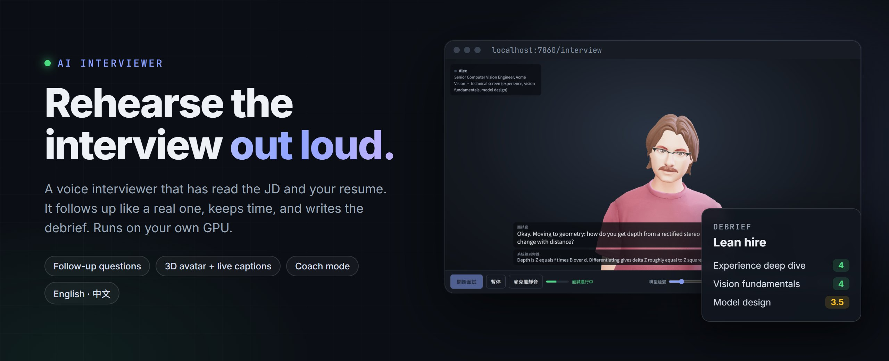
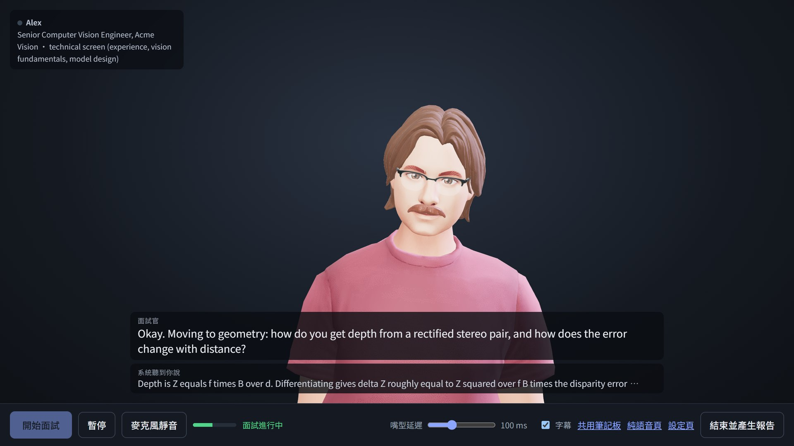
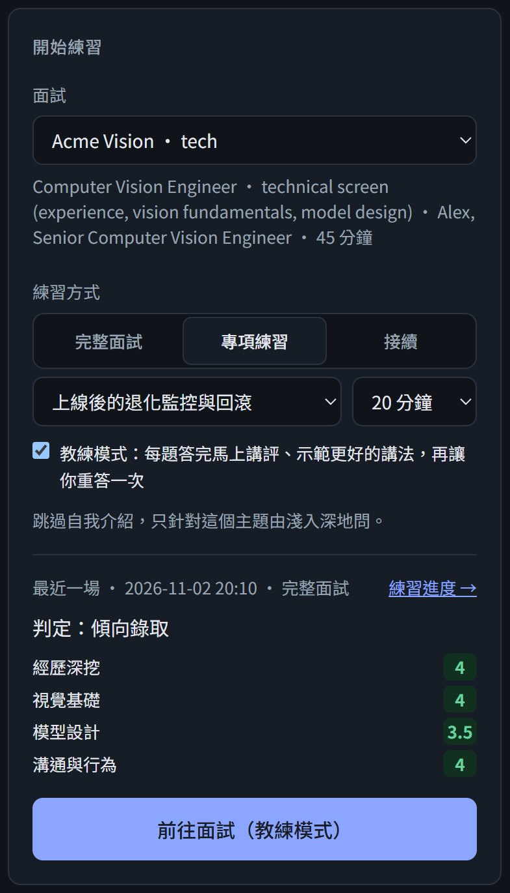
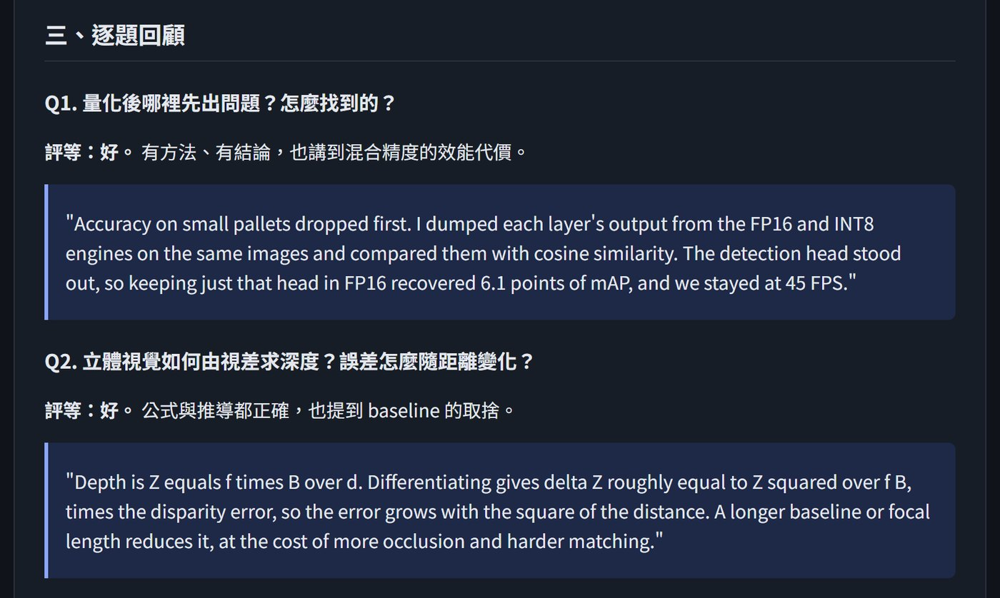
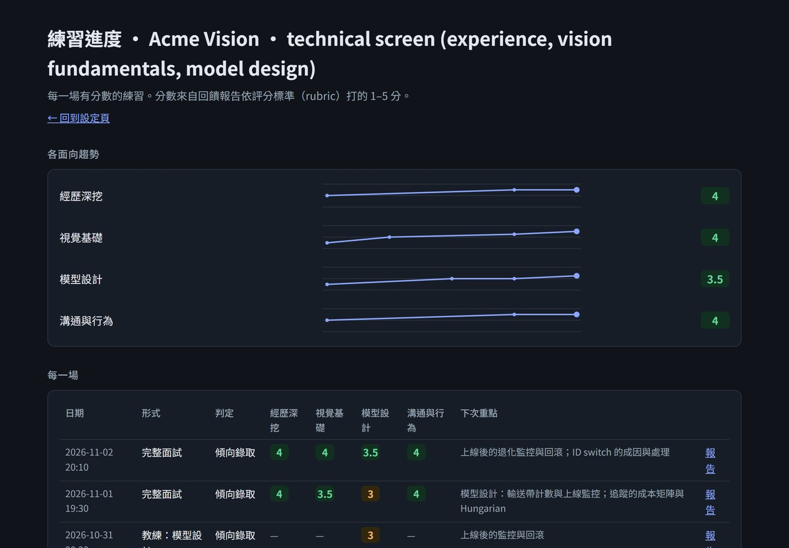
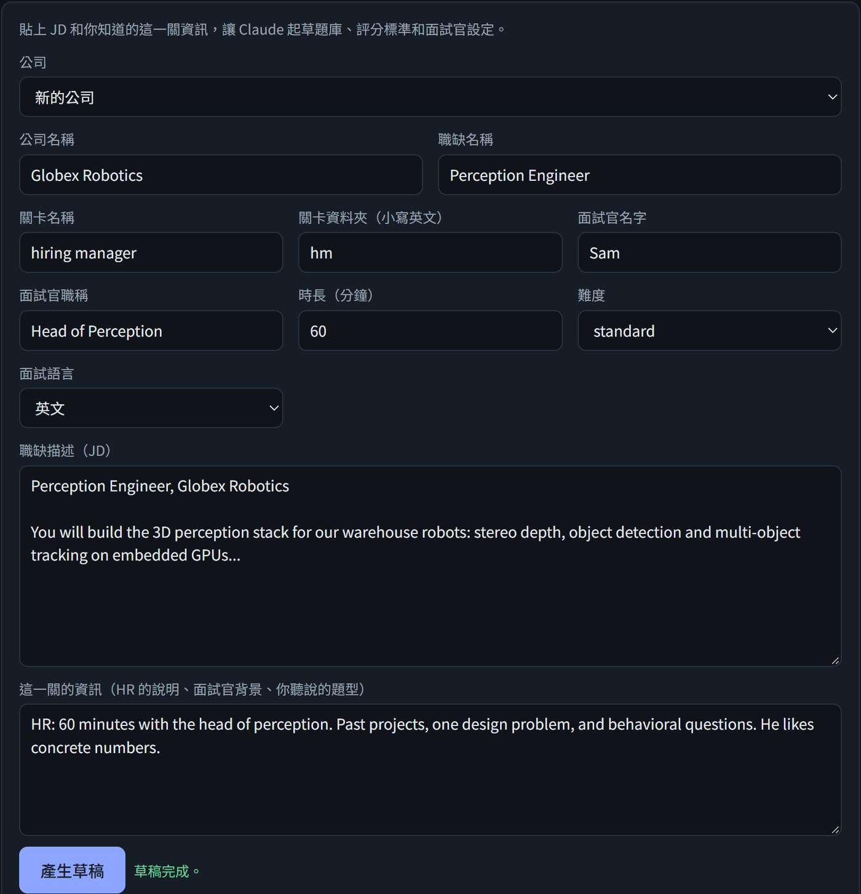
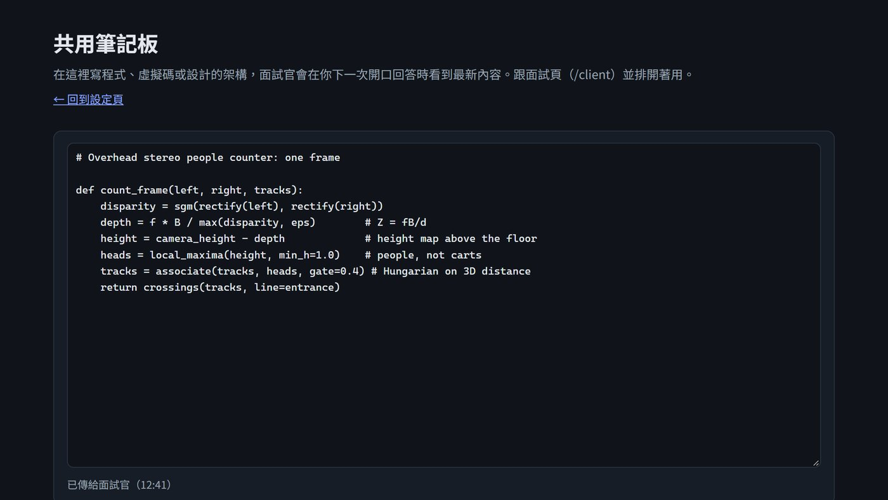
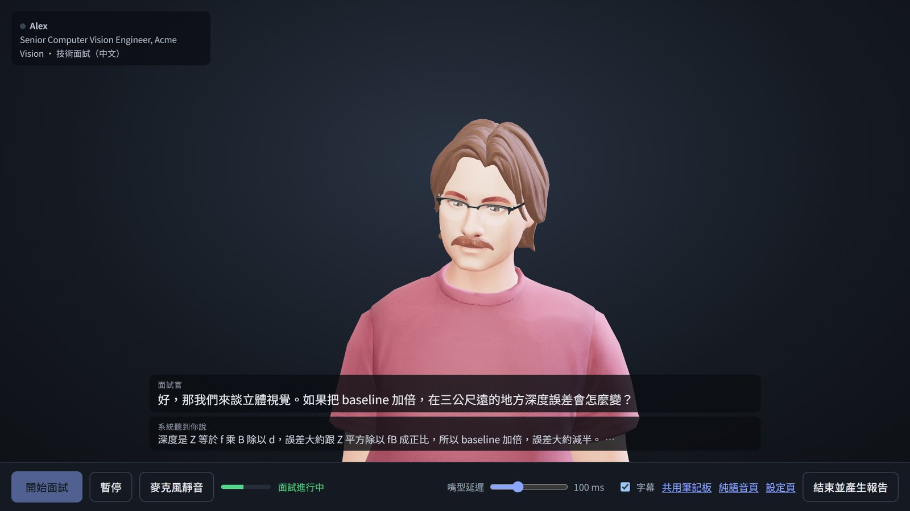
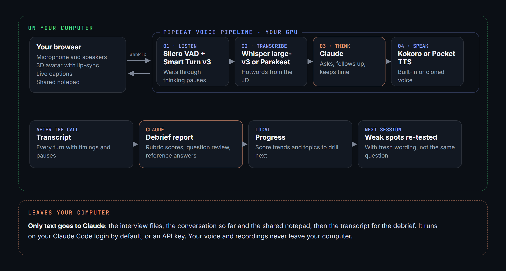

<p align="center">
  
</p>

<p align="center"><strong>開口練的模擬面試。</strong></p>

<p align="center">一位讀過職缺描述、你的履歷和這一關資訊的語音面試官。<br>它會提問、追問、控制時間，結束後寫回饋報告。除了語言模型，其他全部在你自己的 GPU 上執行。</p>

<p align="center">
  <a href="README.md">English</a> &nbsp;·&nbsp; <strong>繁體中文</strong>
</p>

<p align="center">
  <a href="#畫面">畫面</a> &nbsp;·&nbsp;
  <a href="#四種練習方式">四種練習方式</a> &nbsp;·&nbsp;
  <a href="#面試結束之後">面試結束之後</a> &nbsp;·&nbsp;
  <a href="#面試官會做什麼">面試官會做什麼</a> &nbsp;·&nbsp;
  <a href="#運作方式">運作方式</a> &nbsp;·&nbsp;
  <a href="#開始使用">開始使用</a> &nbsp;·&nbsp;
  <a href="INSTALL.zh-TW.md">安裝指南</a>
</p>

<p align="center">
  
  
  
  
  
  <a href="LICENSE"></a>
</p>

---

## 畫面

<p align="center"></p>

> repo 附的虛構範例 [`interviews/example/`](interviews/example/)，Acme Vision 的技術面試。面試官正要進入立體視覺的題目：它說話時問題會以字幕出現，下面一行是語音辨識聽到你說的話，聽錯了當場就看得到。這些畫面裡的候選人和分數都是虛構的。

---

## 讀過答案，不等於講得出來

答案你明明知道，到了現場還是會卡住：先講了一堆背景才講到重點、忘了講讓專案亮眼的那個數字、被一個沒料到的追問問倒。

解法是把答案講出來，講給一個會追問的人聽。這個專案就是那個人，面試前一晚凌晨一點也在。它讀過 JD、你的履歷和你手上這一關的資訊；你漏了數字，它會要數字；你跳過取捨，它會問「為什麼選這個、不選另一個」。它也記得你上次哪裡答不好，換個問法再考一次。

---

## 四種練習方式

<table>
  <tr>
    <td width="38%" valign="top">
      
    </td>
    <td valign="top">
      <h3>1. 完整面試</h3>
      從自我介紹一路到「你有什麼問題想問我們」，照這一關的結構進行。它會控制時間，時間到自己收尾。
      <h3>2. 專項練習</h3>
      針對一個主題練 10 到 30 分鐘，從基礎問到深入的追問。主題可以選上次報告建議加強的、評分標準裡的面向，或自己輸入。
      <h3>3. 教練模式</h3>
      每答完一題就停下來：先說哪裡答得好，再指出漏掉什麼，用你自己的經驗示範更好的講法，然後請你重答一次。
      <h3>4. Coding 面試</h3>
      題目即時從 LeetCode 抓，可以依難度（可複選）、題型標籤和 rating 範圍篩選，用 Python 或 C++ 作答。題目顯示在共用筆記板上，你在旁邊寫程式、邊寫邊講。預設用面試官的寫法，只寫大概，限制和邊界情況要自己問。面試官會先問你的解法和複雜度，卡住時依序給提示，寫完請你用範例走一遍，用特定輸入點出 bug，時間夠就出第二題。報告用 coding 的評分標準，附上參考解法。
      <br><br>
      每一場都可以暫停；斷線了，之後也能接著同一場繼續。
    </td>
  </tr>
</table>

---

## 面試結束之後

<table>
  <tr>
    <td width="50%" valign="top">
      <br>
      <strong>大約一分鐘產生回饋報告。</strong><br>
      依這一關的評分標準打分，並引用你的原話當證據；最強與最弱的時刻；每一題的評等，加上一段你講得出口、只用你真實經歷寫成的參考答案；你還沒準備到的追問；回答長度、開口前停頓和語速。
    </td>
    <td width="50%" valign="top">
      <br>
      <strong>看得到的進步。</strong><br>
      每個評分面向隨場次的趨勢，加上每一場的判定和下次該練的主題。這些主題會變成專項練習的建議；下一場開始前，面試官也會讀到你的弱點，換個問法再考。
    </td>
  </tr>
</table>

---

## 面試官會做什麼

<table>
  <tr>
    <td width="50%" valign="top">
      <br>
      <strong>每家公司、每一關分開準備。</strong><br>
      貼上職缺描述和你知道的這一關資訊，Claude 會依 JD 和你的履歷起草這一關的說明、題庫、評分標準和語音辨識提示詞，檢查後按「建立」。每家公司可以用自己版本的履歷。
    </td>
    <td width="50%" valign="top">
      <br>
      <strong>它看得到你寫的東西。</strong><br>
      遇到寫程式或系統設計題，在面試頁旁邊打開共用筆記板。你下次開口時，面試官就會讀到你寫的內容，並針對特定幾行追問。
    </td>
  </tr>
  <tr>
    <td valign="top">
      <br>
      <strong>英文或中文面試。</strong><br>
      設定 <code>interview_language: zh-TW</code>，面試就改用中文進行：繁體中文、台灣用語，技術名詞保留英文。語音辨識、聲音、字幕和報告都會一起切換。
    </td>
    <td valign="top">
      <strong>它像面試官，不像聊天機器人。</strong>
      <ul>
        <li>一次只問一題，用簡短的口語，不會每題都誇你。</li>
        <li>回答太籠統、只說「我們」卻沒說你做了什麼、或沒講結果時，它會追問。</li>
        <li>你停下來想的時候它會等（Smart Turn v3），不會搶話；你插話時它會停下來。</li>
        <li><code>difficulty: tough</code> 會讓它更常質疑你的推論，也一直追著要數字。</li>
        <li>3D 虛擬面試官在瀏覽器裡繪製，嘴型跟著聲音動。可以用內建聲音，或複製一段你有權使用的聲音。</li>
      </ul>
    </td>
  </tr>
</table>

---

## 運作方式

<p align="center"></p>

| 環節 | 用什麼 |
|---|---|
| 語音流程 | [Pipecat](https://github.com/pipecat-ai/pipecat) 1.12，透過 WebRTC |
| 判斷輪到誰說話 | Silero VAD + Smart Turn v3，本機執行 |
| 語音辨識 | Whisper large-v3（faster-whisper）或 NVIDIA Parakeet TDT 0.6B v3，本機 GPU。可以用 `scripts/compare_stt.py` 拿你自己的聲音比較 |
| 面試官 | Claude，預設透過你的 Claude Code 登入，也可以用 Anthropic API key |
| 聲音 | Kokoro（GPU）、Pocket TTS 內建或複製聲音（CPU）、中文用 Kokoro v1.1-zh |
| 虛擬面試官 | [TalkingHead](https://github.com/met4citizen/TalkingHead) 加 [HeadAudio](https://github.com/met4citizen/HeadAudio) 嘴型同步，在瀏覽器裡執行 |

---

## 開始使用

**需要**

- Linux，或 Windows 的 WSL2
- NVIDIA GPU，6 GB 以上 VRAM，驅動支援 CUDA 12（也可以只用 CPU，會比較慢，見 [INSTALL.zh-TW.md](INSTALL.zh-TW.md#沒有-gpu-的跑法)）
- Python 3.10 到 3.12，約 15 GB 硬碟空間
- 安裝好並用 `claude` 登入過一次的 **[Claude Code](https://claude.com/claude-code)**（或 Anthropic API key）
- 耳機，避免面試官聽到自己的聲音

**接著**

```bash
./scripts/setup_gpu.sh                  # 建 venv、安裝套件、換成 GPU 版 onnxruntime
source .venv/bin/activate
source scripts/cuda_env.sh              # 讓程式找得到 CUDA 函式庫，每開一個新終端機都要跑
python scripts/download_models.py       # 下載模型（約 4 GB）並檢查 GPU
python bot.py                   # 然後打開 http://localhost:7860/
```

選範例面試、選練習方式，按「前往面試」。範例面試的回饋報告是英文；想要中文報告，把 `interviews/example/company.yaml` 的 `feedback_language` 改成 `Traditional Chinese (Taiwan)`。完整步驟和疑難排解在 **[INSTALL.zh-TW.md](INSTALL.zh-TW.md)**，所有設定在 **[docs/reference.zh-TW.md](docs/reference.zh-TW.md)**。

要準備真正的面試，在設定頁用「新增公司或關卡」，或複製 [`interviews/_template/`](interviews/_template/)。你自己的公司資料夾、履歷、逐字稿和錄音都在 `.gitignore` 裡，只會留在你的電腦上。

---

## 隱私與費用

- **會離開你電腦的東西**：只有送給 Claude 的文字，也就是面試設定檔和面試中的對話，以及寫回饋報告時的逐字稿。你的聲音和存下來的錄音都留在本機。
- **費用**：預設的 Claude Code 模式用的是你的 Claude 方案，會算進方案的用量額度；改成 `LLM_BACKEND=api` 則依 Claude API 價格按 token 計費；`LLM_BACKEND=openai` 依該服務收費（本機模型免費）。其他部分都免費、在本機執行。

## 已知限制

- 網頁介面只有繁體中文；面試本身可以是英文或中文（測得最多），也可以是日文、西班牙文、法文、義大利文、巴西葡萄牙文或印地文。
- prompt 是針對 Claude 寫的。`LLM_BACKEND=openai` 也能接 OpenAI 或本機模型（Ollama、LM Studio），但其他模型遵守面試規則可能比較不可靠。
- 在 WSL2（Ubuntu）加 NVIDIA GPU 上開發與測試，一般 Linux 應該一樣可用。不支援原生 Windows 和 macOS。
- 中文聲音是大陸口音，英文術語念得比較不自然，這是目前本機輕量模型的限制。
- 每輪時間是近似值，Whisper 也會濾掉部分「呃」「嗯」，所以贅字只能粗略判斷。
- 複製聲音時，只能用你有權使用、本人同意的聲音。

---

## 第三方模型與素材

本專案自己的程式碼採 MIT 授權。下載的模型和素材不在 repo 裡，各自適用自己的授權條款：

- 語音辨識：[Whisper](https://github.com/openai/whisper)（MIT，透過 faster-whisper），或 [NVIDIA Parakeet TDT v3](https://huggingface.co/nvidia/parakeet-tdt-0.6b-v3)（CC-BY-4.0）。
- 聲音：[Kokoro](https://huggingface.co/hexgrad/Kokoro-82M) 和 Kokoro v1.1-zh（Apache-2.0），中文和日文發音用 [misaki](https://github.com/hexgrad/misaki)（Apache-2.0）和 pyopenjtalk（MIT）；[Pocket TTS](https://huggingface.co/kyutai/pocket-tts)（需先在 Hugging Face 同意條款）。
- 頭像：[TalkingHead](https://github.com/met4citizen/TalkingHead) 和 [HeadAudio](https://github.com/met4citizen/HeadAudio)（MIT）。頭像 `david.glb` 和 `brunette.glb` 由 Ready Player Me 製作；`david.glb` 僅供個人使用，`brunette.glb` 是 CC BY-NC 4.0（非商業用途）。
- Coding 題目和 rating 來自 [LeetCode](https://leetcode.com/) 和 [zerotrac/leetcode_problem_rating](https://github.com/zerotrac/leetcode_problem_rating)，只為你自己的練習抓取，不會重新散布。

**複製聲音：** 只能複製本人同意使用的聲音。

## 參與開發

歡迎開 issue 和 pull request。`python -m pytest` 不需要 GPU、網路或 Claude 就能跑完測試；修正時請一併加上測試。絕對不要 commit `transcripts/`、`profile/` 或你自己的面試資料夾裡的任何東西。

## 文件

- [INSTALL.zh-TW.md](INSTALL.zh-TW.md)：需求、安裝、第一場面試、疑難排解。
- [docs/reference.zh-TW.md](docs/reference.zh-TW.md)：面試資料夾、回饋報告與練習進度、斷線後接續、所有設定、中文面試、語音辨識模型，以及程式架構。

<details>
<summary><strong>程式架構</strong></summary>

```text
bot.py                 即時語音面試，執行這個（python bot.py）
interviewer/           程式本體（Python 套件）
  server.py            網頁和它的 API
  config.py            載入面試資料夾、設定檢查、填入 prompt 模板
  settings.py          每個程式共用的 .env 載入；設定裡的相對路徑以專案資料夾為準
  transcript.py        寫入與讀回逐字稿
  feedback.py          回饋報告和分數（面試結束自動執行，或 python -m interviewer.feedback）
  analysis.py          從每輪時間算出回答長度、停頓、語速
  history.py           跨場次的弱點、問過的題目、進度資料
  coding.py            Coding 面試：挑題、換題、面試官和報告的說明
  leetcode.py          從 LeetCode 抓題目和 zerotrac 的 rating，快取在本機
  claude_code.py       透過 Claude Code CLI 呼叫面試官，CLI 當掉時自動恢復
  llm.py               報告、履歷轉換、草稿、題目改寫共用的一次性 Claude 呼叫
  setup_wizard.py      新增公司或關卡：草稿與建立
  resume_import.py     把上傳的履歷轉成 resume.md
  speech/
    whisper_stt.py     Whisper：帶入對話上下文、過濾幻覺片段、輸出繁體
    parakeet_stt.py    Parakeet：每段回答結束後整段重新辨識
    stt_common.py      兩種辨識共用：回答音訊、專有名詞修正、Parakeet 下載
    chinese.py         中文文字處理：轉繁體、空格與標點、字數
    chinese_tts.py     中文面試官的聲音（Kokoro v1.1-zh）
scripts/
  setup_gpu.sh         一次性安裝：venv、套件、GPU 版 onnxruntime
  cuda_env.sh          讓 pip 裝的 CUDA 函式庫被找到（每個終端機 source 一次）
  download_models.py   下載模型並檢查 GPU
  compare_stt.py       用你自己的錄音比較語音辨識模型
web/                   設定頁、面試頁、報告頁、進度頁、筆記板
prompts/               prompt 模板：面試官、報告、Coding、履歷、新增關卡
interviews/            每家公司一個資料夾、每一關一個子資料夾；_template/ 和 example/ 會進 git
profile/               你的通用履歷（不進 git）
transcripts/           逐字稿、報告、分數，依面試分資料夾（不進 git）
tests/                 自動化測試（不需要 GPU、網路或 Claude）
```

</details>
